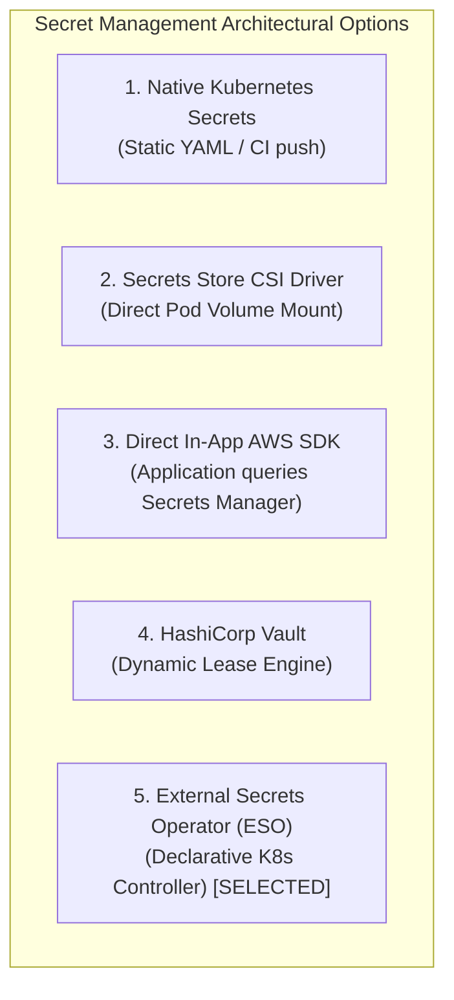

# ADR-006: External Secrets Synchronization & Application Adoption Strategy

## Status

Accepted

---

## Context

In Milestone #25, we established the Kubernetes-native secret trust boundaries across storage (etcd), API authorization (RBAC), and node delivery (`tmpfs` volume projections vs. process environment variables). We demonstrated that Base64 encoding is mere data representation rather than cryptographic confidentiality, and that committing secret manifests to Git violates core security hygiene.

However, native Kubernetes Secrets do not solve the authoritative secret lifecycle:
1. **Source of Truth:** Where do production credentials originate, who manages rotation schedules, and how are secrets secured with hardware-backed encryption (KMS)?
2. **Dynamic Ingestion:** How do credentials flow into the cluster without human operators executing imperative `kubectl create secret` commands or CI/CD pipelines possessing broad cluster administrative access?
3. **The Synchronization vs. Adoption Boundary:** When an external credential rotates, how does the system propagate that change from the cloud provider down to the running application process?

A pervasive operational trap in cloud-native platforms is:

$$
\text{ExternalSecret Ready} = \text{Kubernetes Secret Updated} \ne \text{Application Process Adopted} \ne \text{Downstream Auth Successful}
$$

To establish a resilient enterprise secret delivery model on AWS EKS, we must evaluate how external credentials are synchronized into Kubernetes and how application runtimes consume them.

---

## Problem Statement

A production database password or third-party API token rotates in AWS Secrets Manager.

The platform relies on an operator to reconcile external state into Kubernetes. If the controller updates the target Kubernetes `kind: Secret` object, engineers frequently assume:

> *"The ExternalSecret status reports `SecretSynced=True`. The Kubernetes Secret has been updated. The deployment is healthy."*

This assumption hides three distinct failure boundaries:
1. **The Delivery Plane Freeze:** If the workload consumes credentials via environment variables (`env[].valueFrom.secretKeyRef`), the Linux kernel resolves those variables during container process initialization (`execve()`). Updating the underlying Kubernetes Secret has **zero effect** on the running container's environment. The container process continues executing with the stale, revoked credential indefinitely until restarted.
2. **The In-Memory Caching Boundary:** Even if delivered via projected volume mounts, applications that cache credentials into long-lived connection pools or static configuration variables at startup will not reload the credential from disk without explicit file watching (`inotify`) or a rolling rollout.
3. **The Premature Revocation Hazard:** If the database administrator revokes the old password immediately after updating AWS Secrets Manager, every application replica enters a cascade of authentication failures before the operator synchronizes the secret or before workloads restart.

We must select an external secrets architecture that provides automated synchronization while establishing deterministic operational procedures for credential adoption and revocation.

---

## Decision

We establish the following architectural policies for External Secrets Management:

### 1. Standardize on External Secrets Operator (ESO) v0.9.11
We adopt **External Secrets Operator (ESO) v0.9.11** with the `external-secrets.io/v1beta1` CRD API specification:
- Operates as a declarative, in-cluster Kubernetes controller that reconciles external provider state into native Kubernetes Secret objects.
- Uses AWS Secrets Manager as the authoritative cloud secret store.
- Supports configurable polling and reconciliation intervals (`refreshInterval: 1h`) to detect upstream credential rotations.

### 2. Isolate Controller Identity from Workload Identity via EKS IRSA
- The ESO controller authenticates to AWS Secrets Manager using **IAM Roles for Service Accounts (IRSA)** or **EKS Pod Identity**.
- The dedicated controller ServiceAccount (`eso-irsa-sa`) is annotated with the IAM Role ARN.
- Workload application pods use an unprivileged ServiceAccount (`external-secret-app-sa`) that possesses **zero AWS IAM permissions**, preventing workloads from querying cloud provider APIs directly.
- **Access Boundary Realities:**
  - Removing AWS IAM permissions prevents cloud API traversal, but does **not** prevent compromise of the Kubernetes Secret delivered to the workload container. If the workload is compromised (e.g. via RCE), its delivered credentials can still be exfiltrated.
  - Identities with pod creation or exec permissions (`pods/create`, `pods/exec`) in the namespace can mount or extract secrets. Complete isolation requires combining IAM scoping, namespace RBAC, and admission controls.

### 3. Enforce Namespaced `SecretStore` Boundaries
- Workloads must use namespaced `kind: SecretStore` resources rather than cluster-wide `ClusterSecretStore` resources, unless multi-tenant sharing is explicitly approved.
- A namespaced `SecretStore` establishes a localized configuration scope within the namespace.
- **Tenant Isolation Nuance:** A namespaced store does not independently guarantee complete tenant isolation. Effective multi-tenant isolation requires coordinated enforcement of AWS IAM policy scoping on the projected IRSA role, Kubernetes RBAC governing `secrets` and `externalsecrets`, admission policies, and node/workload isolation.

### 4. Require Declarative `ExternalSecret` with Owner Policy
- `ExternalSecret` manifests explicitly declare `spec.target.creationPolicy: Owner`. If the `ExternalSecret` is deleted, its generated Kubernetes Secret is garbage-collected.
- Credentials map directly to specific JSON properties or raw strings using `spec.data[].remoteRef`.

### 5. Mandate Deployment Rollouts & Qualify Dual-Credential Strategy
- Because process environment variables are immutable at runtime, and in-memory application connection pools do not automatically reload, **credential rotation is not complete upon Secret synchronization**.
- **The Complete 7-Step Rotation Lifecycle:**
  1. *Authoritative credential update:* Upstream secret updated in AWS Secrets Manager.
  2. *ESO reconciliation:* Controller polls provider and detects changed version.
  3. *Kubernetes Secret update:* Local `kind: Secret` updated in etcd and cluster memory.
  4. *Workload delivery:* Updated secret reflected via pod filesystem mount or queued for next pod creation.
  5. *Application adoption:* Workload reloads configuration (via rolling restart or file watcher).
  6. *Downstream authentication verification:* Workload verifies valid connection to downstream datastore.
  7. *Old credential revocation:* Previous credential revoked at datastore with rollback/recovery contingency.
- **Rotation Strategy Qualification:** A dual-credential overlap period is the preferred strategy **when the downstream system supports simultaneous valid credentials** (e.g., dual database users or staged API keys). Where only one active credential is supported, teams must accept coordinated downtime, synchronized rolling deployments with exponential retry backoff, or temporary maintenance windows; zero-downtime rotation cannot be guaranteed universally.

---

## Architectural Trust Boundaries

```text
[ AWS Secrets Manager ] 
          │ (1. Provider Plane: Authoritative Key-Value Store & KMS Encryption)
          ▼
[ External Secrets Operator ] ─── (2. Controller Identity: EKS IRSA / Pod Identity)
          │
          │ (3. Synchronization Plane: Polling loop, secretStoreRef, reconcile)
          ▼
[ Kubernetes kind: Secret ] ─── (4. Cluster Storage: etcd persistence)
          │
          ├── (5A. Volume Projection: tmpfs symlink swap; requires app reload)
          └── (5B. Environment Variable: Immutable at execve; requires pod restart)
          ▼
[ Application Process ] ─── (6. Adoption Plane: In-memory heap / connection pool)
          │
          ▼
[ Downstream Datastore ] ─── (7. Downstream Auth Plane: Validates active credential)
```

### Boundary 1: Authoritative Provider vs. Cluster State
- AWS Secrets Manager manages rotation schedules, KMS envelope encryption, and IAM audit logs.
- The Kubernetes Secret object is a localized, downstream mirror. The mirror can experience synchronization latency bounded by `spec.refreshInterval`.

### Boundary 2: Controller IAM vs. Workload Identity
- ESO requires `secretsmanager:GetSecretValue` and `secretsmanager:DescribeSecret` scoped strictly to target secret ARNs (`production/app/database-*`).
- The application pod requires zero AWS permissions, preventing direct AWS Secrets Manager API queries. However, the workload still receives the native Kubernetes Secret in its environment, meaning workload compromise exposes its delivered credentials locally. Furthermore, Kubernetes `pods/create` and `pods/exec` permissions in the namespace can access secrets unless constrained by RBAC and admission policies.

### Boundary 3: Synchronization vs. Runtime Adoption
- ESO reconciling `SecretSynced=True` only confirms that the Kubernetes Secret `.data` field matches the external provider.
- It does **not** confirm that running pods have loaded the new credential or that the downstream datastore accepts it.

---

## Alternatives Considered



### Alternative 1: Native Kubernetes Secrets (Static Manifests / CI Injection)
- **Description:** Injecting credentials into Kubernetes Secrets via CI/CD pipelines during deployment.
- **Evaluation:** **REJECTED for enterprise secret management.**
  - Requires CI/CD runners to hold broad Kubernetes administrative privileges to create/update secrets.
  - No automated detection of out-of-band rotations initiated in AWS Secrets Manager.
  - Secret drift occurs between the authoritative cloud store and the cluster.

### Alternative 2: Secrets Store CSI Driver (Mount-Based Direct Projection)
- **Description:** Using the Kubernetes Secrets Store CSI Driver with the AWS Secrets Manager provider to mount secrets directly into pods as volumes.
- **Evaluation:** **VIABLE BUT REJECTED FOR GENERAL WORKLOADS.**
  - *Advantages:* Never writes secrets to etcd unless `syncSecret: true` is configured; secrets exist solely on node `tmpfs`.
  - *Disadvantages:* Tightly couples Pod startup to CSI driver availability and AWS API latency. If AWS Secrets Manager throttles API calls during a massive scale-out event, pod startup blocks (`ContainerCreating`). Does not support environment variables natively. Adds substantial daemonset complexity across worker nodes.

### Alternative 3: Direct In-App AWS SDK Calls
- **Description:** Application microservices embed the AWS SDK and call `GetSecretValue` at startup.
- **Evaluation:** **REJECTED.**
  - *Advantages:* Eliminates all Kubernetes Secret objects and etcd persistence entirely.
  - *Disadvantages:* Tightly couples application code to AWS APIs, breaking vendor independence and complicating local testing/mocking. Every application pod requires AWS IAM permissions. During large autoscaling surges, hundreds of pods hammer AWS Secrets Manager simultaneously, causing API rate limit exhaustion and exorbitant AWS API request costs.

### Alternative 4: HashiCorp Vault (Dynamic Leases)
- **Description:** Deploying HashiCorp Vault with dynamic database credentials and short-lived leases.
- **Evaluation:** **DEFERRED / SPECIALIZED.**
  - *Advantages:* Best-in-class security with short-lived dynamic credentials, lease revocation, and automated database user provisioning.
  - *Disadvantages:* Significant operational burden. Requires operating a highly available Vault cluster (or paying substantial HCP Vault SaaS fees), managing unseal keys, complex Raft storage, and specialized operational runbooks. For teams whose primary infrastructure is AWS EKS, native AWS Secrets Manager backed by ESO provides 90% of the benefit with a fraction of the operational overhead.

---

## Trade-offs & Consequences

### What We Gain
1. **Authoritative Cloud Source:** Secrets originate in AWS Secrets Manager with KMS envelope encryption, automatic rotation schedules, and AWS CloudTrail auditability.
2. **Declarative GitOps Compatibility:** Manifests commit safely to Git (`SecretStore` and `ExternalSecret`) with zero credential exposure. The actual `kind: Secret` is generated dynamically by the controller.
3. **Decoupled Identity:** Application workloads have no access to AWS IAM credentials or Secrets Manager APIs.
4. **Resilient Local Caching:** Because ESO creates a native Kubernetes Secret, pods can restart, scale out, or reschedule during transient AWS Secrets Manager API outages without blocking startup.

### What We Incur
1. **Controller Dependency:** The platform introduces the External Secrets Operator as a critical cluster dependency. If the ESO controller crashes, existing secrets remain, but rotations stop reconciling.
2. **Sync Latency Window:** Credential changes in AWS are not instantaneous; they propagate according to `spec.refreshInterval` (e.g., up to 1 hour unless manually triggered).
3. **Adoption Responsibility:** The platform must enforce rolling deployment rollouts on rotation. Updating the Kubernetes Secret does not update running application memory or process environment variables.
4. **Revocation Discipline:** Teams should enforce a dual-credential overlap window at the authoritative database whenever simultaneous valid credentials are supported; for single-credential systems, teams must plan coordinated maintenance windows or brief rotation restart cycles to prevent outages while pods cycle.
