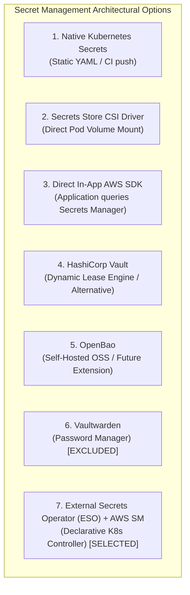

# ADR-006: External Secrets Synchronization & Application Adoption Strategy

## Status

Accepted

---

## Context

In Milestone #25, we established the Kubernetes-native secret trust boundaries across storage (etcd), API authorization (RBAC), and node delivery (`tmpfs` volume projections vs. process environment variables). We demonstrated that Base64 encoding is mere data representation rather than cryptographic confidentiality, and that committing secret manifests to Git violates core security hygiene.

However, native Kubernetes Secrets do not solve the authoritative secret lifecycle:
1. **Source of Truth:** Where do production credentials originate, who manages rotation schedules, and how are secrets secured with hardware-backed encryption (KMS)?
2. **Dynamic Ingestion:** How do credentials flow into the cluster without human operators executing imperative `kubectl create secret` commands or CI/CD pipelines possessing broad cluster administrative access?
3. **The Synchronization vs. Adoption Boundary:** When an external credential rotates, how does the system propagate that change from the cloud provider down to the running application process?

A pervasive operational trap in cloud-native platforms is:

$$
\text{ExternalSecret Ready} = \text{Kubernetes Secret Updated} \ne \text{Application Process Adopted} \ne \text{Downstream Auth Successful}
$$

To establish a resilient enterprise secret delivery model on AWS EKS, we must evaluate how external credentials are synchronized into Kubernetes and how application runtimes consume them.

---

## Problem Statement

A production database password or third-party API token rotates in an authoritative external secret store.

The platform relies on an operator to reconcile external state into Kubernetes. If the controller updates the target Kubernetes `kind: Secret` object, engineers frequently assume:

> *"The ExternalSecret status reports `SecretSynced=True`. The Kubernetes Secret has been updated. The deployment is healthy."*

This assumption hides critical lifecycle failure boundaries:
1. **The Delivery Plane Freeze (Environment Variables):** If the workload consumes credentials via environment variables (`env[].valueFrom.secretKeyRef`), the Linux kernel resolves those variables during container process initialization (`execve()`). Updating the underlying Kubernetes Secret has **zero effect** on the running container's environment. The container process continues executing with the stale, revoked credential indefinitely until restarted.
2. **The Volume Mount Symlink Gap & `subPath` Trap:** If delivered via standard projected volume mounts, kubelet eventually updates files on `tmpfs` via symlink rotation (`..data`), but running applications that cache credentials into long-lived connection pools will not reload them without file watching (`inotify`) or a restart. Crucially, if a secret is mounted using `subPath`, **automated updates are completely disabled by Kubernetes**, freezing the mounted file to its initial boot-time state.
3. **The Adoption vs. Downstream Auth Gap:** Even if an application successfully reloads a new credential into memory, this does not prove the downstream datastore or service accepts it (e.g., misconfigured permissions, network partitions, or delayed replication).
4. **The Premature Revocation Hazard:** If the database administrator revokes the old password immediately after updating the external store, every application replica enters a cascade of authentication failures before the operator synchronizes the secret or before workloads restart.

We must select an external secrets architecture that provides automated synchronization while establishing deterministic operational procedures for credential adoption and revocation.

---

## Decision

We establish the following architectural policies for External Secrets Management:

### 1. Standardize on External Secrets Operator (ESO) v0.9.11
We adopt **External Secrets Operator (ESO) v0.9.11** with the `external-secrets.io/v1beta1` CRD API specification:
- Operates as a declarative, in-cluster Kubernetes controller that reconciles external provider state into native Kubernetes Secret objects.
- Evaluates and provides concrete, independently configurable reference implementations for two primary architectures:
  1. **AWS Secrets Manager:** Managed cloud backend for AWS EKS environments.
  2. **OpenBao:** Self-hosted open-source backend using ESO's Vault-compatible provider schema.
- Supports configurable polling and reconciliation intervals (`refreshInterval: 1h`) to detect upstream credential rotations.

### 2. Backend Roles & Implementation Architecture

We implement both backends as separate, independently configurable reference workloads:

#### Implementation A: AWS Secrets Manager (Managed Cloud Backend)
- **Workload Directory:** `kubernetes/workloads/external-secret-demo/`
- **Provider Schema:** `spec.provider.aws` (`service: SecretsManager`, `region: us-east-1`).
- **Authentication:** Dedicated controller identity (`eso-irsa-sa`) authenticates via IAM Roles for Service Accounts (IRSA) using AWS STS `AssumeRoleWithWebIdentity`.
- **Security Boundary:** AWS IAM permission policies strictly scoped to secret ARNs (`production/app/database-*`) and KMS CMK key policies.

#### Implementation B: OpenBao (Self-Hosted Open-Source Backend)
- **Workload Directory:** `kubernetes/workloads/openbao-external-secret-demo/`
- **Provider Schema Rationale:** OpenBao is an open-source, community-governed fork of HashiCorp Vault under the Linux Foundation (MPL-2.0). The pinned ESO v0.9.11 release contains **no dedicated native `provider.openbao` CRD block**. Because OpenBao maintains strict HTTP API compatibility with Vault v1/v2 secret engines, ESO interfaces with OpenBao using the official `spec.provider.vault` schema.
- **Authentication:** Dedicated controller identity (`openbao-client-sa`) authenticates via the **Kubernetes Auth Method** (`auth.kubernetes`), presenting its projected ServiceAccount JWT to OpenBao's login endpoint. OpenBao verifies the token via the Kubernetes API server (`TokenReview`) and issues a scoped client token bound to role `openbao-app-role`.
- **TLS Trust Anchor:** Enforces TLS verification using `caProvider` referencing ConfigMap `openbao-ca-cert`.
- **Security Boundary:** OpenBao internal ACL path policies (`path "secret/data/app/*" { capabilities = ["read"] }`).

#### Authentication Differences & Provider Security Comparison

| Property | AWS Secrets Manager Implementation | OpenBao Implementation |
| :--- | :--- | :--- |
| **Provider Schema** | `spec.provider.aws` | `spec.provider.vault` (Vault-compatible API) |
| **Authentication Flow** | IRSA: Projected JWT $\to$ AWS STS $\to$ Temporary IAM credentials | K8s Auth: Projected JWT $\to$ OpenBao Login $\to$ Kubernetes TokenReview |
| **Policy Enforcement** | AWS IAM Policies + KMS Key Policies | OpenBao Path-based HCL ACL Policies |
| **Trust Anchor** | AWS public CA / Private CA | Internal PKI via `caProvider` ConfigMap |
| **Operational Overhead** | Zero cluster operational burden; AWS managed service | Requires operating HA OpenBao cluster, unseal keys, and storage backend |

#### Provider-Specific Security Boundaries & Realities
- **Decoupled Controller vs. Workload Identity:** In both implementations, the application workload ServiceAccount (`external-secret-app-sa` or `openbao-app-workload-sa`) possesses **zero external provider permissions** (no AWS IAM, no OpenBao tokens).
- **Workload Secret Access Reality:** Denying external provider access prevents lateral traversal to cloud or Vault APIs, but the application **still receives the native Kubernetes Secret** delivered to its container. Workload compromise exposes its delivered credentials locally.
- **Indirect Access Paths:** An identity with `pods/create` or `pods/exec` in the namespace can mount or inspect any secret. While Pod Security Standards (PSS) enforce execution security properties (e.g., non-root user, dropped capabilities), **PSS alone does not prevent authorized Pod creators from referencing Secrets**. Complete isolation requires combining namespace RBAC, workload authorization design, and fine-grained admission policies (e.g., Kyverno, Gatekeeper, ValidatingAdmissionPolicy).
- **Namespaced Store Boundary:** A namespaced `SecretStore` establishes a localized configuration scope within `sample-workloads`. A namespaced `SecretStore` does **not** create a complete or impermeable security boundary on its own; tenant isolation requires coordinated backend ACLs, IAM scoping, RBAC, and admission policies.

#### Explicit Exclusion of Vaultwarden
- **Vaultwarden is strictly excluded from the ESO architecture.**
- Vaultwarden is a lightweight, Bitwarden-compatible password manager server intended for personal/team user password storage and browser extension syncing.
- Vaultwarden is **not** an equivalent Kubernetes workload-secret backend.
- Vaultwarden is **not** a policy engine, **not** a Kubernetes secret controller, and **not** an application credential rotation solution.
- It provides no External Secrets Operator provider integration and has no role in automated workload credential delivery.

### 3. Isolate Controller Identity from Workload Identity via EKS IRSA
- The ESO controller authenticates to AWS Secrets Manager using **IAM Roles for Service Accounts (IRSA)** or **EKS Pod Identity**.
- The dedicated controller ServiceAccount (`eso-irsa-sa`) is annotated with the IAM Role ARN.
- Workload application pods use an unprivileged ServiceAccount (`external-secret-app-sa`) that possesses **zero AWS IAM permissions**, preventing workloads from querying cloud provider APIs directly.
- **Access Boundary Realities:**
  - Removing AWS IAM permissions prevents cloud API traversal, but does **not** prevent compromise of the Kubernetes Secret delivered to the workload container. If the workload is compromised (e.g. via RCE), its delivered credentials can still be exfiltrated.
  - Identities with pod creation or exec permissions (`pods/create`, `pods/exec`) in the namespace can mount or extract secrets. While Pod Security Standards (PSS) enforce execution security properties (e.g., non-root user, dropped capabilities), **PSS alone does not prevent authorized Pod creators from referencing Secrets**. Complete isolation requires combining IAM scoping, namespace RBAC, workload authorization design, and fine-grained admission policies (e.g., Kyverno, Gatekeeper, ValidatingAdmissionPolicy).

### 4. Enforce Namespaced `SecretStore` Boundaries
- Workloads must use namespaced `kind: SecretStore` resources rather than cluster-wide `ClusterSecretStore` resources, unless multi-tenant sharing is explicitly approved.
- A namespaced `SecretStore` establishes a localized configuration scope within the namespace.
- **Tenant Isolation Nuance:** A namespaced `SecretStore` does **not** create a complete or impermeable security boundary on its own. Effective multi-tenant isolation requires coordinated enforcement of AWS IAM policy scoping on the projected IRSA role, Kubernetes RBAC governing `secrets` and `externalsecrets`, admission policies, and node/workload isolation.

### 5. Require Declarative `ExternalSecret` with Owner Policy
- `ExternalSecret` manifests explicitly declare `spec.target.creationPolicy: Owner`. If the `ExternalSecret` is deleted, its generated Kubernetes Secret is garbage-collected.
- Credentials map directly to specific JSON properties or raw strings using `spec.data[].remoteRef`.

### 6. Verify the Complete 6-Stage Credential Lifecycle
Because process environment variables are immutable at runtime, `subPath` mounts never update, and in-memory application connection pools do not automatically reload, **credential rotation is not complete upon Secret synchronization**.

The complete lifecycle consists of six distinct stages:

```text
External Secret Backend (AWS Secrets Manager / Vault / OpenBao)
        │ (1. Upstream rotation / version staging)
        ▼
External Secrets Operator (ESO Controller)
        │ (2. IRSA / Pod Identity authentication, poll loop)
        ▼
Kubernetes Secret (Target in etcd)
        │ (3. etcd persistence, resourceVersion mutation)
        ▼
Pod Credential Delivery Plane
        ├── Path A: Environment Variables (FROZEN at container execve; requires pod restart)
        ├── Path B: Projected Volume Mount (Kubelet ..data symlink swap; requires app reload)
        └── Path C: Mounted via subPath (FROZEN; kubelet NEVER updates subPath mounts)
        ▼
Application Reload / Restart / Credential Adoption Plane
        │ (5. In-memory heap, connection pool refresh, or new pod boot)
        ▼
Downstream Authentication Plane
        │ (6. Datastore verifies credential; old credential revoked safely)
```

#### Key Lifecycle Behaviors:
1. **Environment variables are established at container start:** The Linux kernel initializes environment tables once during container process creation (`execve()`). Updating the Kubernetes Secret does not mutate the environment of an already-running process.
2. **Secret volume projections update eventually, but the application must re-read the updated file:** Kubelet periodically rotates the `..data` symlink on `tmpfs` volume projections (typically 60-90s). However, application processes that read configuration into static in-memory variables or connection pools at boot will not observe the new secret without file-watching logic (`inotify`) or a restart.
3. **A Secret mounted using `subPath` does not receive automated updates:** When a Secret volume is mounted into a container using `subPath` or `subPathExpr`, kubelet binds directly to the specific file inode at mount time, completely bypassing symlink projection. `subPath` volume mounts **never** receive automated updates when the Secret changes.
4. **ESO Ready confirms controller synchronization, not application adoption:** An `ExternalSecret` condition of `Ready=True` and `SecretSynced` indicates only that the controller successfully mirrored the external payload into Kubernetes etcd. It asserts nothing about running process state.
5. **Successful application adoption still does not prove downstream authentication:** Even if an application reads the updated credential from disk or boots fresh with updated environment variables, downstream authentication can still fail due to database permission errors, account lockouts, network firewalls, or delayed database replication.
6. **Old credential revocation must be coordinated with verified adoption and downstream authentication:** Revoking old credentials before 100% of workload replicas have adopted the new credential and verified downstream authentication causes catastrophic cluster-wide authentication outages.

---

## Architectural Trust Boundaries

```text
[ External Secret Backend: AWS Secrets Manager ]
          │ (1. Provider Plane: Authoritative Key-Value Store & KMS Encryption)
          ▼
[ External Secrets Operator ] ─── (2. Controller Identity: EKS IRSA / Pod Identity)
          │
          │ (3. Synchronization Plane: Polling loop, secretStoreRef, reconcile)
          ▼
[ Kubernetes kind: Secret ] ─── (4. Cluster Storage: etcd persistence)
          │
          ├── (5A. Volume Projection: tmpfs symlink swap; requires app reload)
          ├── (5B. Environment Variable: Immutable at execve; requires pod restart)
          └── (5C. subPath Mount: Inode-bound; NEVER updated by kubelet)
          ▼
[ Application Process ] ─── (6. Adoption Plane: In-memory heap / connection pool)
          │
          ▼
[ Downstream Datastore ] ─── (7. Downstream Auth Plane: Validates active credential)
```

### Boundary 1: Authoritative Provider vs. Cluster State
- AWS Secrets Manager manages rotation schedules, KMS envelope encryption, and IAM audit logs. (OpenBao and HashiCorp Vault represent alternative self-hosted/enterprise backends).
- The Kubernetes Secret object is a localized, downstream mirror. The mirror can experience synchronization latency bounded by `spec.refreshInterval`.

### Boundary 2: Controller IAM vs. Workload Identity
- ESO requires `secretsmanager:GetSecretValue` and `secretsmanager:DescribeSecret` scoped strictly to target secret ARNs (`production/app/database-*`).
- The application pod requires zero AWS permissions, preventing direct AWS Secrets Manager API queries. However, the workload still receives the native Kubernetes Secret in its environment, meaning workload compromise exposes its delivered credentials locally. Furthermore, Kubernetes `pods/create` and `pods/exec` permissions in the namespace can access secrets unless constrained by RBAC and fine-grained admission policies (since Pod Security Standards govern execution posture, not Secret-reference authorization).

### Boundary 3: Synchronization vs. Runtime Adoption
- ESO reconciling `SecretSynced=True` only confirms that the Kubernetes Secret `.data` field matches the external provider.
- It does **not** confirm that running pods have loaded the new credential or that the downstream datastore accepts it.

---

## Alternatives Considered



### Alternative 1: Native Kubernetes Secrets (Static Manifests / CI Injection)
- **Description:** Injecting credentials into Kubernetes Secrets via CI/CD pipelines during deployment.
- **Evaluation:** **REJECTED for enterprise secret management.**
  - Requires CI/CD runners to hold broad Kubernetes administrative privileges to create/update secrets.
  - No automated detection of out-of-band rotations initiated in the authoritative secret backend.
  - Secret drift occurs between the authoritative cloud store and the cluster.

### Alternative 2: Secrets Store CSI Driver (Mount-Based Direct Projection)
- **Description:** Using the Kubernetes Secrets Store CSI Driver with the AWS Secrets Manager provider to mount secrets directly into pods as volumes.
- **Evaluation:** **VIABLE BUT REJECTED FOR GENERAL WORKLOADS.**
  - *Advantages:* Never writes secrets to etcd unless `syncSecret: true` is configured; secrets exist solely on node `tmpfs`.
  - *Disadvantages:* Tightly couples Pod startup to CSI driver availability and AWS API latency. If AWS Secrets Manager throttles API calls during a massive scale-out event, pod startup blocks (`ContainerCreating`). Does not support environment variables natively. Adds substantial daemonset complexity across worker nodes.

### Alternative 3: Direct In-App AWS SDK Calls
- **Description:** Application microservices embed the AWS SDK and call `GetSecretValue` at startup.
- **Evaluation:** **REJECTED.**
  - *Advantages:* Eliminates all Kubernetes Secret objects and etcd persistence entirely.
  - *Disadvantages:* Tightly couples application code to AWS APIs, breaking vendor independence and complicating local testing/mocking. Every application pod requires AWS IAM permissions. During large autoscaling surges, hundreds of pods hammer AWS Secrets Manager simultaneously, causing API rate limit exhaustion and exorbitant AWS API request costs.

### Alternative 4: HashiCorp Vault (Dynamic Leases)
- **Description:** Deploying HashiCorp Vault with dynamic database credentials and short-lived leases.
- **Evaluation:** **VIABLE ALTERNATIVE / SPECIALIZED.**
  - *Advantages:* Best-in-class security with short-lived dynamic credentials, lease revocation, and automated database user provisioning.
  - *Disadvantages:* Significant operational burden. Requires operating a highly available Vault cluster (or paying substantial HCP Vault SaaS fees), managing unseal keys, complex Raft storage, and specialized operational runbooks. For teams whose primary infrastructure is AWS EKS, native AWS Secrets Manager backed by ESO provides 90% of the benefit with a fraction of the operational overhead.

### Alternative 5: OpenBao (Self-Hosted Open-Source Backend)
- **Description:** Deploying OpenBao (Linux Foundation open-source fork of Vault) as a self-hosted secrets backend.
- **Evaluation:** **IMPLEMENTED SEPARATELY VIA VAULT-COMPATIBLE PROVIDER.**
  - *Advantages:* True open-source licensing (MPL-2.0), no BSL licensing restrictions, strict Vault API compatibility.
  - *Integration in Pinned ESO v0.9.11:* ESO v0.9.11 has no native `spec.provider.openbao` CRD block. We implement OpenBao in `kubernetes/workloads/openbao-external-secret-demo/` using the official `spec.provider.vault` schema with Kubernetes token authentication (`auth.kubernetes`) and ConfigMap CA bundle verification. This models self-hosted secrets delivery without fabricating an unsupported CRD schema.

### Alternative 6: Vaultwarden
- **Description:** Lightweight Bitwarden-compatible password manager server.
- **Evaluation:** **EXCLUDED FROM ARCHITECTURE.**
  - Vaultwarden is a user-facing credential manager designed for personal/team password vaults and browser extension synchronization.
  - It is **not** a Kubernetes workload-secret backend, **not** a policy engine, **not** a Kubernetes secret controller, and **not** an application credential rotation solution.
  - It has no provider API in ESO and is out of scope for workload secret delivery.

---

## Trade-offs & Consequences

### What We Gain
1. **Authoritative Cloud Source:** Secrets originate in AWS Secrets Manager with KMS envelope encryption, automatic rotation schedules, and AWS CloudTrail auditability.
2. **Declarative GitOps Compatibility:** Manifests commit safely to Git (`SecretStore` and `ExternalSecret`) with zero credential exposure. The actual `kind: Secret` is generated dynamically by the controller.
3. **Decoupled Identity:** Application workloads have no access to AWS IAM credentials or Secrets Manager APIs.
4. **Resilient Local Caching:** Because ESO creates a native Kubernetes Secret, pods can restart, scale out, or reschedule during transient AWS Secrets Manager API outages without blocking startup.
5. **Clear Backend Distinction:** AWS Secrets Manager is the primary managed implementation, with OpenBao and Vault evaluated as distinct alternative backends (not three co-dependent requirements).

### What We Incur
1. **Controller Dependency:** The platform introduces the External Secrets Operator as a critical cluster dependency. If the ESO controller crashes, existing secrets remain, but rotations stop reconciling.
2. **Sync Latency Window:** Credential changes in AWS are not instantaneous; they propagate according to `spec.refreshInterval` (e.g., up to 1 hour unless manually triggered).
3. **Adoption Responsibility:** The platform must enforce rolling deployment rollouts on rotation. Updating the Kubernetes Secret does not update running application memory, process environment variables, or `subPath` volume mounts.
4. **Revocation Discipline:** Teams should enforce a dual-credential overlap window at the authoritative database whenever simultaneous valid credentials are supported; for single-credential systems, teams must plan coordinated maintenance windows or brief rotation restart cycles to prevent outages while pods cycle.
