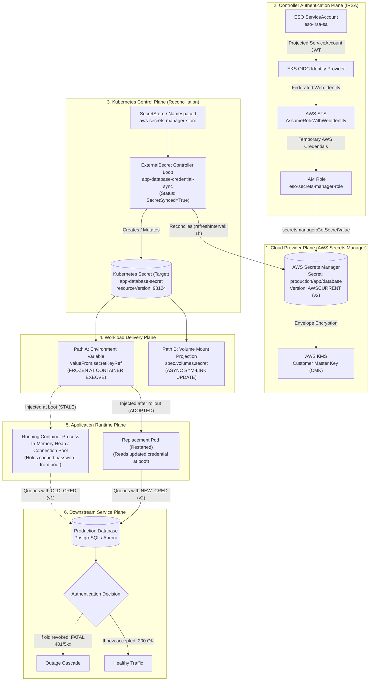

# External Secrets Trust Boundaries & Synchronization Architecture

Secret synchronization is not application credential adoption.

When an external credential manager like AWS Secrets Manager updates a password, the change traverses seven distinct system boundaries before client traffic successfully authenticates. A failure at any single boundary stops the rotation dead, even if every preceding layer reports a green status.

```text
ExternalSecret Ready ≠ Application Credential Adopted ≠ Downstream Auth Successful
```

---

## The End-to-End Credential Delivery Lifecycle



---

## Detailed Trust Boundary Analysis

### Boundary 1: Authoritative Provider Availability & Versioning
- **Location:** AWS Secrets Manager.
- **Responsibility:** Houses the single source of truth for the sensitive credential. Controls version staging (`AWSCURRENT`, `AWSPREVIOUS`, custom version stages) and KMS envelope encryption.
- **Failure Mode:** AWS API throttling (`ThrottlingException`), regional endpoint failure, or missing KMS decrypt permissions (`kms:Decrypt`).
- **Boundary Truth:** A healthy credential in AWS Secrets Manager does not mean Kubernetes is aware of it. Reconciliation happens on a periodic schedule (`refreshInterval`).

---

### Boundary 2: Controller IAM Authentication & Authorization (EKS IRSA)
- **Location:** EKS OIDC Provider $\to$ AWS STS $\to$ AWS IAM.
- **Responsibility:** Grants the External Secrets Operator controller temporary AWS credentials without storing long-lived static AWS Access Keys in the cluster.
- **Mechanism:**
  1. Kubelet injects a projected service account JWT token into the ESO controller pod.
  2. The AWS SDK in the ESO pod calls `sts:AssumeRoleWithWebIdentity`, presenting the projected JWT.
  3. STS validates the JWT against the EKS cluster's OIDC discovery endpoint.
  4. STS returns temporary AWS access credentials scoped to the IAM role.
- **Least-Privilege Scoping:**
  ```json
  {
    "Version": "2012-10-17",
    "Statement": [
      {
        "Sid": "AllowReadAppDatabaseSecret",
        "Effect": "Allow",
        "Action": [
          "secretsmanager:GetSecretValue",
          "secretsmanager:DescribeSecret"
        ],
        "Resource": "arn:aws:secretsmanager:us-east-1:123456789012:secret:production/app/database-*"
      }
    ]
  }
  ```
- **Boundary Truth:** If the IAM role trust policy does not match the exact ServiceAccount namespace and name, or if the role lacks `secretsmanager:GetSecretValue` on the specific secret ARN, ESO fails with `AccessDeniedException`. While workload application pods are denied access to this cloud IAM role, they still possess local access to the Kubernetes Secret delivered to their container. Compromise of the workload exposes its own delivered credentials, and namespace users with pod-creation or exec privileges can inspect secrets unless constrained by RBAC and fine-grained admission policies (as Pod Security Standards govern execution posture, not Secret-reference authorization).

---

### Boundary 3: The Reconciliation Loop (`SecretStore` & `ExternalSecret`)
- **Location:** Kubernetes Control Plane (`kube-apiserver` & ESO Controller).
- **Responsibility:** Evaluates `ExternalSecret` specifications against the configured `SecretStore`.
- **Tenant Scope:** A namespaced `kind: SecretStore` establishes a localized configuration scope within `sample-workloads`. It does not independently guarantee complete multi-tenant isolation without corresponding IAM policy resource scoping, RBAC governance, and workload admission controls.
- **Reconciliation Invariants:**
  - `SecretStore` defines the connection parameters (AWS service, region, authentication reference).
  - `ExternalSecret` defines the refresh cadence (`refreshInterval: 1h`), the target Kubernetes Secret name (`target.name`), and the mapping from external keys to secret keys.
- **Boundary Truth:** When the reconciliation loop succeeds, ESO sets:
  ```yaml
  status:
    conditions:
      - type: Ready
        status: "True"
        reason: SecretSynced
  ```
  This status proves **only** that the controller successfully fetched the payload from AWS and wrote it into the Kubernetes `kind: Secret` object in etcd. It asserts nothing about workload health.

---

### Boundary 4: Workload Credential Delivery (Env Var vs. Volume Mount)
- **Location:** Kubelet daemon & Container Runtime on the worker node.
- **The Two Delivery Paths:**

| Delivery Mechanism | Initial Injection | In-Flight Secret Mutation Behavior | Operational Consequence |
| :--- | :--- | :--- | :--- |
| **Environment Variable (`secretKeyRef`)** | Resolved once during container process `execve()`. | **Completely frozen.** The Linux kernel does not update environment tables of running processes. | Running containers retain the old credential until the pod is terminated and replaced. |
| **Volume Mount (`volumes[].secret`)** | Mounted on node memory `tmpfs`. | **Asynchronously updated.** Kubelet swaps the `..data` symlink within 60–90 seconds. | File on disk updates, but application process memory does not update unless an `inotify` watcher is implemented. |

---

### Boundary 5: Application Credential Adoption
- **Location:** Application Process Virtual Memory (Heap, Connection Pool, Environment Table).
- **Responsibility:** The running code must read the new credential and apply it to downstream connections.
- **The Staleness Trap:**
  - Database connection pools (e.g., HikariCP, pgpool, SQLAlchemy) initialize database connections during startup using the credentials available in memory at boot time.
  - If a secret rotates in AWS Secrets Manager and synchronizes to the Kubernetes Secret object, the application process never re-reads its environment variables.
  - The process continues executing with the old credential until explicitly restarted via `kubectl rollout restart`.

---

### Boundary 6: Downstream Authentication & The Revocation Window
- **Location:** The Target Service (PostgreSQL, MySQL, Redis, External SaaS API).
- **Responsibility:** Accepts or rejects the authentication request.
- **The Premature Revocation Hazard:**
  - **Rotation** is the introduction and propagation of a new credential.
  - **Revocation** is the deactivation of the old credential.
  - An overlap period where both old and new credentials remain valid is the preferred strategy **when the downstream service supports simultaneous valid credentials**.
  - In single-credential environments where simultaneous credentials cannot be maintained, teams must coordinate planned maintenance or synchronized rolling updates with connection retry logic; universal zero-downtime rotation cannot be promised.
  - If an upstream operator revokes the old password before:
    1. ESO completes its reconciliation loop, AND
    2. All application pods complete a rolling restart,
  - **Result:** Every active pod in the cluster immediately enters an authentication failure storm (`FATAL: password authentication failed`), triggering cascading 500 errors and CrashLoopBackOff states.

---

## The Four Diagnostic Golden Rules

1. **ExternalSecret `SecretSynced=True` does NOT prove the app is using the new password.** It only proves the Kubernetes Secret object in etcd has been updated.
2. **Kubernetes Secret `.data` updated does NOT prove the running container has seen it.** If delivered via environment variables, `/proc/$PID/environ` remains frozen to the boot-time value.
3. **Mounted volume file updated does NOT prove application RAM has reloaded it.** In-memory database pools continue authenticating with the old password until an internal reload or pod restart occurs.
4. **Where simultaneous valid credentials are supported, maintain a dual-credential overlap window until 100% of workload replicas complete a verified rolling rollout under the new credential before revoking the old credential.** For single-credential systems, plan coordinated rollout windows.
