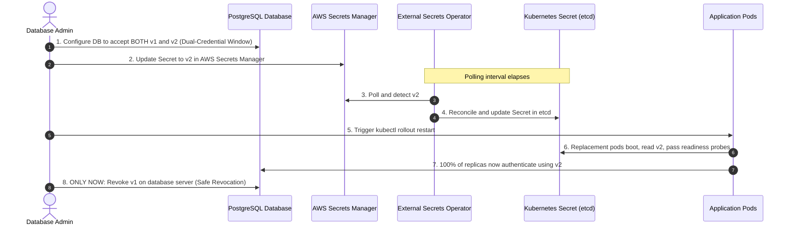

# Failure Scenario 3: Premature Old-Credential Revocation

## Status: DESIGNED / STATICALLY VALIDATED

> [!NOTE]
> **Evidence Status: DESIGNED / STATICALLY VALIDATED**
> Rotation lifecycle boundaries and dual-credential transition policies are verified statically in `scripts/validate.sh`. Command outputs below demonstrate database connection failures and rolling update timelines, labeled as **ILLUSTRATIVE**.

---

## 1. Situation

A high-throughput payment processing service in `sample-workloads` queries an Amazon Aurora PostgreSQL database.

Security compliance mandates monthly database credential rotation.

At `10:00 AM`, the database administrator:
1. Generates a new database password `Pass#2026_v2` in AWS Secrets Manager under `production/app/database`.
2. Changes the master database password on the PostgreSQL cluster to `Pass#2026_v2`.
3. **Immediately drops/revokes the previous password `Pass#2026_v1`** to ensure old credentials cannot be used.

---

## 2. Assumption

The database administrator observes:

> *"The new password is live in AWS Secrets Manager. Kubernetes uses the External Secrets Operator to manage secrets. The platform will automatically handle credential propagation."*

The assumption is that external secret synchronization happens synchronously and instantaneously across all running application instances.

---

## 3. Hidden Problem

Within seconds of dropping the old password, 100% of the application pods begin logging authentication errors:

```bash
kubectl logs -n sample-workloads -l app.kubernetes.io/name=external-secret-demo --tail=10
```

*Illustrative Output:*
```text
2026-10-11T10:00:15Z [FATAL] org.postgresql.util.PSQLException: FATAL: password authentication failed for user "app_admin"
2026-10-11T10:00:17Z [FATAL] Connection pool exhausted. Terminating worker threads.
2026-10-11T10:00:20Z [ERROR] HTTP 500 Internal Server Error returned to client traffic.
```

Client error rates spike from 0.01% to 100%. The service experiences a complete platform outage.

---

## 4. Evidence (Timeline Breakdown)

To understand why the outage occurred, we evaluate the timeline discrepancy across the three system layers:

```text
Timeline of the Outage:

10:00:00 AM ── Database Admin updates AWS Secrets Manager (v1 -> v2)
10:00:05 AM ── Database Admin REVOKES v1 on PostgreSQL server (CRITICAL MISTAKE)
10:00:10 AM ── Running Pods attempt database queries with v1 -> REJECTED (Outage Begins)
10:00:45 AM ── ESO is still waiting for its refreshInterval timer (Next poll at 10:45 AM)
10:01:00 AM ── Kubernetes Secret 'app-database-secret' STILL CONTAINS v1 IN ETCD!
10:05:00 AM ── Operator manually triggers rollout restart -> Replacement pods boot with v1!
10:05:30 AM ── Replacement pods STILL FAIL because etcd has not synced v2 yet!
```

**The Two Synchronization Gaps:**
1. **The Polling Window Gap:** `ExternalSecret` reconciles on a periodic schedule (`refreshInterval: 1h`). AWS Secrets Manager does not push events into Kubernetes by default; ESO pulls them. Between `10:00 AM` and `10:45 AM`, the Kubernetes Secret object in etcd **still holds the old password**.
2. **The Workload Rollout Gap:** Even after ESO updates the Kubernetes Secret, rolling out replacement pods across hundreds of replicas takes several minutes to satisfy readiness probes and PodDisruptionBudgets.

Because the old credential was revoked at `10:00:05 AM`, there was zero overlap window. The application had zero opportunity to transition gracefully.

---

## 5. Mechanism: The Dual-Credential Overlap Window



### The Golden Rule of Credential Lifecycle
$$
\text{Rotation} \ne \text{Revocation}
$$
- **Rotation:** Generating and propagating a new credential.
- **Revocation:** Invalidating the previous credential.
- **Invariant:** Revocation must always lag rotation by the maximum propagation and verification window (typically 24–48 hours in production).

---

## 6. Resolution & Prevention

### Prevention: Credential Strategy by System Capability

#### Strategy A: Dual-Credential Overlap Window (Preferred When Supported)
When the downstream system supports concurrent valid credentials (e.g., dual database user accounts, secondary API keys, or staged IAM access keys):
1. **Authoritative Credential Update:** Provision the new credential in the downstream system and update AWS Secrets Manager (`production/app/database`), keeping the old credential valid.
2. **ESO Reconciliation:** Verify `ExternalSecret` transitions to `Ready: True` / `SecretSynced`.
3. **Kubernetes Secret Update:** Verify `app-database-secret` in etcd reflects an incremented `resourceVersion`.
4. **Workload Delivery & Application Adoption:** Execute a controlled rolling rollout (`kubectl rollout restart deployment/external-secret-demo -n sample-workloads`) so replacement pods boot with the new credential.
5. **Downstream Authentication Verification:** Monitor application telemetry to confirm 100% of replicas successfully authenticate using the new credential.
6. **Old Credential Revocation:** Decommission the old credential at the downstream system only after the verification period concludes.

#### Strategy B: Single-Credential Systems (Coordination Trade-offs)
Where the downstream system strictly supports only **one** active credential at a time:
- Universal zero-downtime rotation **cannot** be guaranteed.
- **Trade-off Analysis:**
  - *Option 1: Planned Maintenance Window:* Temporarily redirect ingress traffic or announce a scheduled maintenance window during credential swap and pod rollouts.
  - *Option 2: Synchronized Rollout with Retry Backoff:* Update the database credential and AWS Secrets Manager simultaneously, trigger an immediate emergency ESO refresh (`kubectl annotate es <name> force-sync=...`), and rollout pods while client libraries execute exponential connection retry backoff.
  - *Acceptance:* Transient connection rejection occurs while running pods terminate and replacement pods initialize.

### Emergency Recovery: If Premature Revocation Occurs
If an upstream credential is inadvertently dropped before workloads transition:
1. **Immediate Database Rollback:** Re-enable the previous password on the database server immediately to restore service to running pods.
2. **Do Not Churn Pods:** Restarting pods while the upstream database rejects credentials simply converts running pods into `CrashLoopBackOff` pods.
