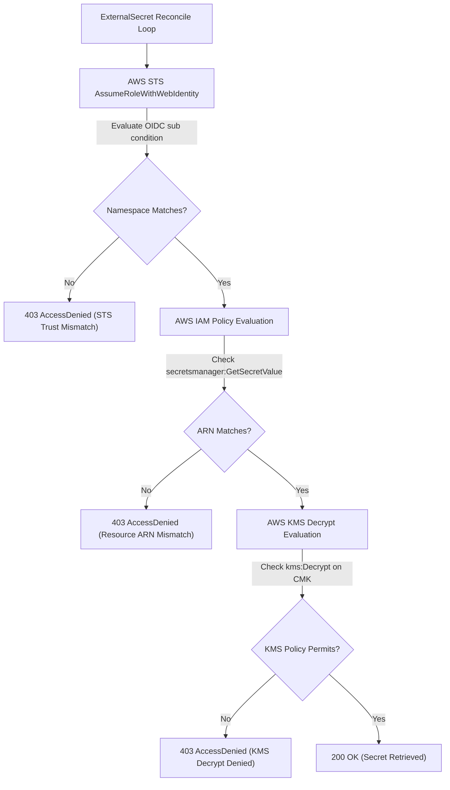

# Failure Scenario 2: Provider Access Denied (IAM & KMS Authorization Failure)

## Status: DESIGNED / STATICALLY VALIDATED

> [!NOTE]
> **Evidence Status: DESIGNED / STATICALLY VALIDATED**
> ServiceAccount annotations and IAM scoping patterns are validated in `scripts/validate.sh`. Command outputs below demonstrate AWS STS web identity federation and External Secrets Operator error conditions, labeled as **ILLUSTRATIVE**.

---

## 1. Situation

A new microservice in `sample-workloads` deploys an `ExternalSecret` manifest referencing AWS Secrets Manager secret `production/app/database`.

The operator configures the controller ServiceAccount `eso-irsa-sa` with an IAM role annotation:

```yaml
apiVersion: v1
kind: ServiceAccount
metadata:
  name: eso-irsa-sa
  namespace: sample-workloads
  annotations:
    eks.amazonaws.com/role-arn: "arn:aws:iam::123456789012:role/eso-secrets-manager-role"
```

The operator applies the `SecretStore` and `ExternalSecret` manifests:

```bash
kubectl apply -f kubernetes/workloads/external-secret-demo/secretstore.yaml
kubectl apply -f kubernetes/workloads/external-secret-demo/externalsecret.yaml
```

---

## 2. Assumption

The platform operator observes:

> *"The ServiceAccount is annotated with the IAM Role ARN. AWS IRSA will automatically grant the External Secrets Operator permission to retrieve the secret."*

The assumption is that configuring the ServiceAccount annotation is sufficient to establish end-to-end authorization.

---

## 3. Hidden Problem

The target Kubernetes Secret `app-database-secret` is never created.

The consuming deployment enters `CreateContainerConfigError` because the referenced Secret is missing:

```bash
kubectl get pods -n sample-workloads -l app.kubernetes.io/name=external-secret-demo
```

*Illustrative Output:*
```text
NAME                                    READY   STATUS                       RESTARTS   AGE
external-secret-demo-7bf659b84c-v7k2q   0/1     CreateContainerConfigError   0          2m
```

Checking the `ExternalSecret` status reveals a reconciliation failure:

```bash
kubectl get externalsecret app-database-credential-sync -n sample-workloads
```

*Illustrative Output:*
```text
NAME                           STORE                       STORE-TYPE    RESOURCE-STATUS   STATUS
app-database-credential-sync   aws-secrets-manager-store   SecretStore   SecretSyncedError False
```

---

## 4. Evidence (Diagnostic Walkthrough)

Inspecting the events on the `ExternalSecret` resource provides the exact failure trace:

```bash
kubectl describe externalsecret app-database-credential-sync -n sample-workloads
```

*Illustrative Event Stream:*
```text
Events:
  Type     Reason               Age                From              Message
  ----     ------               ----               ----              -------
  Warning  UpdateFailed         45s (x3 over 2m)   external-secrets  could not get secret from provider: AccessDeniedException: User: arn:aws:sts::123456789012:assumed-role/eso-secrets-manager-role/1728604800 is not authorized to perform: secretsmanager:GetSecretValue on resource: arn:aws:secretsmanager:us-east-1:123456789012:secret:production/app/database-AbCdEf
```

Evaluating the IAM authorization boundary reveals three common root causes:

### Root Cause 1: IAM Policy Resource ARN Mismatch
The IAM role's permission policy specified:
```json
"Resource": "arn:aws:secretsmanager:us-east-1:123456789012:secret:production/app/database"
```
However, AWS Secrets Manager appends a 6-character random suffix to secret ARNs (e.g., `-AbCdEf`). The policy must use a wildcard suffix:
```json
"Resource": "arn:aws:secretsmanager:us-east-1:123456789012:secret:production/app/database-*"
```

### Root Cause 2: KMS Key Policy Lockout
The secret in AWS Secrets Manager was encrypted using a Customer Managed Key (CMK). While the IAM role had `secretsmanager:GetSecretValue`, the KMS Key Policy did not permit the role to call `kms:Decrypt`.

### Root Cause 3: OIDC Trust Relationship Condition Mismatch
The IAM Role trust policy contained a typo in the OIDC federated condition:
```json
"Condition": {
  "StringEquals": {
    "oidc.eks.us-east-1.amazonaws.com/id/EXAMPLE:sub": "system:serviceaccount:default:eso-irsa-sa"
  }
}
```
The workload runs in `sample-workloads`, but the trust policy specified namespace `default`. AWS STS rejected token exchange during `AssumeRoleWithWebIdentity`.

---

## 5. Mechanism & Resolution



### Resolution Steps
1. **Update IAM Role Trust Relationship:** Ensure the `sub` string matches `system:serviceaccount:sample-workloads:eso-irsa-sa`.
2. **Harden IAM Permission Policy:** Scope the resource ARN with a trailing wildcard:
   ```json
   {
     "Version": "2012-10-17",
     "Statement": [
       {
         "Effect": "Allow",
         "Action": [
           "secretsmanager:GetSecretValue",
           "secretsmanager:DescribeSecret"
         ],
         "Resource": "arn:aws:secretsmanager:us-east-1:123456789012:secret:production/app/database-*"
       }
     ]
   }
   ```
3. **Grant KMS Decrypt (if CMK used):** Add `kms:Decrypt` on the CMK ARN.
4. **Trigger Immediate Re-Sync:** Rather than waiting for the 1-hour `refreshInterval`, annotate the `ExternalSecret`:
   ```bash
   kubectl annotate externalsecret app-database-credential-sync -n sample-workloads \
     force-sync=$(date +%s) --overwrite
   ```

Verify status transition to `Ready=True, SecretSynced`:

```bash
kubectl get externalsecret app-database-credential-sync -n sample-workloads
```

---

## 6. Trade-off & Operational Consequence

- **Broad IAM Permissions (`Resource: "*"`):** Eliminates `AccessDeniedException` permanently, but destroys tenant boundaries and permits any compromised workload or misconfigured SecretStore to read all secrets across the entire AWS account.
- **Granular Least-Privilege IAM (`Resource: "...:secret:production/app/database-*"`):** Enforces strict cloud-level boundaries, but requires platform teams to manage IAM resource ARNs as part of workload onboarding.
