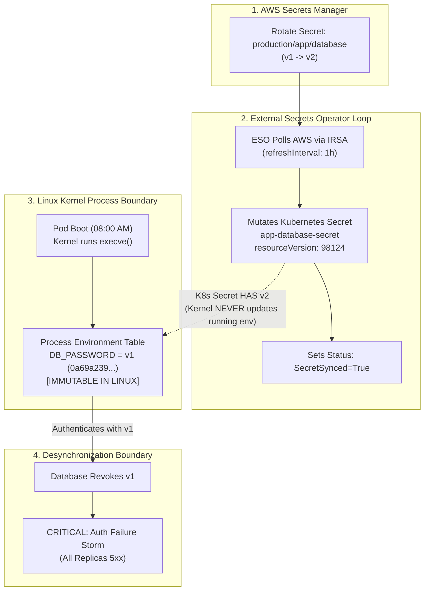

# Failure Scenario 1: Synchronization Succeeded, Application Stayed Stale

## Status: DESIGNED / STATICALLY VALIDATED

> [!NOTE]
> **Evidence Status: DESIGNED / STATICALLY VALIDATED**
> Manifest definitions, CRD schemas, and environment-variable delivery references are statically verified in `scripts/validate.sh`. Command outputs below demonstrate standard Linux kernel environment immutability and External Secrets Operator reconciliation semantics, labeled as **ILLUSTRATIVE**.

---

## 1. Situation

A web service `external-secret-demo` running in `sample-workloads` connects to an Amazon Aurora PostgreSQL database.

The workload injects its database credentials via process environment variables referencing the Kubernetes Secret generated by External Secrets Operator:

```yaml
env:
  - name: DB_PASSWORD
    valueFrom:
      secretKeyRef:
        name: app-database-secret
        key: password
```

The database administrator triggers a scheduled credential rotation in AWS Secrets Manager:
1. Generates a new password for secret `production/app/database`.
2. Updates the AWS Secrets Manager entry, creating version stage `AWSCURRENT` (v2).
3. Configures the database to accept both v1 and v2 during the migration window.

Within minutes, the External Secrets Operator reconciliation loop polls AWS Secrets Manager, detects the version transition, and updates the localized Kubernetes Secret `app-database-secret`:

```bash
kubectl get externalsecret app-database-credential-sync -n sample-workloads
```

*Illustrative Output:*
```text
NAME                           STORE                       STORE-TYPE    RESOURCE-STATUS   STATUS
app-database-credential-sync   aws-secrets-manager-store   SecretStore   Ready             SecretSynced
```

---

## 2. Assumption

The platform operator observes:

> *"The ExternalSecret status reports `Ready=True` and `SecretSynced=True`. The Kubernetes Secret object has been updated with the new password. The application is now using the new credential."*

The assumption is that when a Kubernetes Secret object is mutated in etcd, running application containers automatically adopt the new credential.

---

## 3. Hidden Problem

Twenty-four hours later, the database administrator cleans up the migration window and revokes the previous password (v1) on the PostgreSQL database server.

Instantly, the application begins throwing connection exceptions across all replicas:

```bash
kubectl logs -n sample-workloads -l app.kubernetes.io/name=external-secret-demo --tail=10
```

*Illustrative Output:*
```text
[ERROR] Database connection failed: FATAL: password authentication failed for user "app_admin"
[ERROR] Retrying connection in 5s...
[ERROR] Database connection failed: FATAL: password authentication failed for user "app_admin"
```

Yet, if the operator checks the ExternalSecret and the Kubernetes Secret:

```bash
kubectl get externalsecret app-database-credential-sync -n sample-workloads -o jsonpath='{.status.conditions[0].reason}'
```
*Output:* `SecretSynced`

```bash
kubectl get secret app-database-secret -n sample-workloads -o jsonpath='{.metadata.resourceVersion}'
```
*Output:* `98124` (incremented from initial creation)

The controller succeeded. The Kubernetes Secret object in etcd contains the new password. Why is the application failing authentication?

---

## 4. Evidence (Diagnostic Walkthrough)

To diagnose why the application is failing despite a successful synchronization, the operator compares the running container process initialization timestamp against the Kubernetes Secret mutation timestamp (strictly without printing credential values, lengths, or hashes):

```bash
POD_NAME=$(kubectl get pods -n sample-workloads -l app.kubernetes.io/name=external-secret-demo -o jsonpath='{.items[0].metadata.name}')

# 1. Non-sensitive check: inspect the process startup timestamp from container logs
kubectl logs -n sample-workloads "$POD_NAME" --tail=2
```

*Illustrative Output:*
```text
app-consumer process booted at 2026-10-11T08:00:00Z. Workload revision: 1.0.0. Source: app-database-secret.
Worker active. Process PID: 1, Boot time: 2026-10-11T08:00:00Z, Cycle: 60, Status: SYNTHETIC_AUTH_ESTABLISHED
```

Next, the operator checks the mutation timestamp and resourceVersion of the updated Kubernetes Secret:

```bash
kubectl get secret app-database-secret -n sample-workloads -o jsonpath='{.metadata.resourceVersion} {"\n"} {.metadata.creationTimestamp} {"\n"}'
```

*Illustrative Output:*
```text
98124
2026-10-11T08:30:00Z
```

**The Discrepancy Revealed:**
- **Kubernetes Secret in etcd:** Mutated at `08:30:00Z` (Incremented to `resourceVersion: 98124`, holding v2 credentials).
- **Running Container Process:** Initialized at `08:00:00Z` (Booted 30 minutes *before* secret rotation).
- **Process Environment Table:** Frozen at container `execve()` time (`08:00:00Z`).

The running container is executing with the stale, revoked boot-time credential environment table! Neither the secret value nor any hash or length was emitted to verify this condition.

---

## 5. Mechanism: The Environment-Variable Freeze Boundary



### Why Did This Happen?
1. **Linux Kernel Semantics:** When a container process starts, the Linux kernel invokes the `execve()` system call, which populates the process's initial environment table from the container definition. In Linux, process environment tables are **immutable from the outside**. No external system (neither Kubernetes, kubelet, nor container runtimes) can inject new environment variables into an existing, running process.
2. **ESO Controller Limits:** The External Secrets Operator is a Kubernetes controller. Its boundary ends at the Kubernetes API server (`etcd`). It has no mechanism to reach inside worker node kernel namespaces to alter running processes.
3. **The Synchronization Illusion:** A successful sync means the cloud store and the Kubernetes Secret match. It asserts **nothing** about running process memory.

---

## 6. Resolution: Controlled Rolling Rollout

To force the application to adopt the synchronized credential safely:

### Step 1: Trigger a Rolling Deployment Restart
Cycle all pod replicas so that replacement containers execute `execve()` against the updated Kubernetes Secret:

```bash
kubectl rollout restart deployment/external-secret-demo -n sample-workloads
```

Monitor the rollout progression:

```bash
kubectl rollout status deployment/external-secret-demo -n sample-workloads --timeout=60s
```

*Illustrative Output:*
```text
Waiting for deployment "external-secret-demo" rollout to finish: 1 out of 2 new replicas have been updated...
deployment "external-secret-demo" successfully rolled out
```

### Step 2: Verify Credential Adoption (Independent Operational Signal)
Verify that the new running process booted *after* the secret was mutated in etcd:

```bash
NEW_POD=$(kubectl get pods -n sample-workloads -l app.kubernetes.io/name=external-secret-demo -o jsonpath='{.items[0].metadata.name}')

kubectl logs -n sample-workloads "$NEW_POD" --tail=2
```

*Illustrative Output:*
```text
app-consumer process booted at 2026-10-11T08:35:00Z. Workload revision: 1.0.0. Source: app-database-secret.
Worker active. Process PID: 1, Boot time: 2026-10-11T08:35:00Z, Cycle: 1, Status: SYNTHETIC_AUTH_ESTABLISHED
```

The new process boot timestamp (`08:35:00Z`) postdates the secret mutation timestamp (`08:30:00Z`), confirming the new container initialized its environment table against the updated secret without emitting any credential data.

### Step 3: Verify Downstream Authentication (Application Boundary)
Confirm from application logs that synthetic authentication or downstream connectivity is established:

```bash
kubectl logs -n sample-workloads "$NEW_POD" --tail=1
```

*Illustrative Output:*
```text
Worker active. Process PID: 1, Boot time: 2026-10-11T08:35:00Z, Cycle: 2, Status: SYNTHETIC_AUTH_ESTABLISHED
```

> [!NOTE]
> **Demonstration Boundary Limitation:** The demo workload verifies container process adoption and environment variable immutability using non-sensitive operational logs. Live downstream database authentication requires a target database instance.


---

## 7. Trade-off & Engineering Judgment

### The Trade-off
- **Relying on Environment Variables without Rollouts:** Simple to configure in YAML, but creates a silent staleness trap where credential updates in the cloud never reach running processes until pods crash or restart accidentally.
- **Automating Rolling Rollouts on Secret Updates (e.g., Stakater Reloader or GitOps Pipelines):** Introduces pod churning and transient compute overhead whenever a secret rotates, but guarantees deterministic adoption where no pod runs with stale credentials.

### Engineering Judgment
Never consider a secret rotation complete when the operator reports `SecretSynced`. Credential rotation is complete only when every running container replica has been restarted, re-evaluated against readiness probes, and verified to authenticate successfully against the downstream service.
