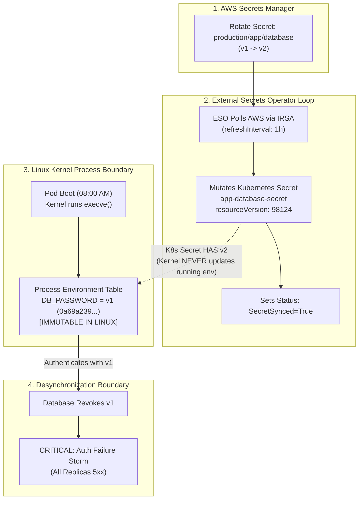

# Failure Scenario 1: Synchronization Succeeded, Application Stayed Stale

## Status: DESIGNED / STATICALLY VALIDATED

> [!NOTE]
> **Evidence Status: DESIGNED / STATICALLY VALIDATED**
> Manifest definitions, CRD schemas, and environment-variable delivery references are statically verified in `scripts/validate.sh`. Command outputs below demonstrate standard Linux kernel environment immutability and External Secrets Operator reconciliation semantics, labeled as **ILLUSTRATIVE**.

---

## 1. Situation

A web service `external-secret-demo` running in `sample-workloads` connects to an Amazon Aurora PostgreSQL database.

The workload injects its database credentials via process environment variables referencing the Kubernetes Secret generated by External Secrets Operator:

```yaml
env:
  - name: DB_PASSWORD
    valueFrom:
      secretKeyRef:
        name: app-database-secret
        key: password
```

The database administrator triggers a scheduled credential rotation in AWS Secrets Manager:
1. Generates a new password for secret `production/app/database`.
2. Updates the AWS Secrets Manager entry, creating version stage `AWSCURRENT` (v2).
3. Configures the database to accept both v1 and v2 during the migration window.

Within minutes, the External Secrets Operator reconciliation loop polls AWS Secrets Manager, detects the version transition, and updates the localized Kubernetes Secret `app-database-secret`:

```bash
kubectl get externalsecret app-database-credential-sync -n sample-workloads
```

*Illustrative Output:*
```text
NAME                           STORE                       STORE-TYPE    RESOURCE-STATUS   STATUS
app-database-credential-sync   aws-secrets-manager-store   SecretStore   Ready             SecretSynced
```

---

## 2. Assumption

The platform operator observes:

> *"The ExternalSecret status reports `Ready=True` and `SecretSynced=True`. The Kubernetes Secret object has been updated with the new password. The application is now using the new credential."*

The assumption is that when a Kubernetes Secret object is mutated in etcd, running application containers automatically adopt the new credential.

---

## 3. Hidden Problem

Twenty-four hours later, the database administrator cleans up the migration window and revokes the previous password (v1) on the PostgreSQL database server.

Instantly, the application begins throwing connection exceptions across all replicas:

```bash
kubectl logs -n sample-workloads -l app.kubernetes.io/name=external-secret-demo --tail=10
```

*Illustrative Output:*
```text
[ERROR] Database connection failed: FATAL: password authentication failed for user "app_admin"
[ERROR] Retrying connection in 5s...
[ERROR] Database connection failed: FATAL: password authentication failed for user "app_admin"
```

Yet, if the operator checks the ExternalSecret and the Kubernetes Secret:

```bash
kubectl get externalsecret app-database-credential-sync -n sample-workloads -o jsonpath='{.status.conditions[0].reason}'
```
*Output:* `SecretSynced`

```bash
kubectl get secret app-database-secret -n sample-workloads -o jsonpath='{.metadata.resourceVersion}'
```
*Output:* `98124` (incremented from initial creation)

The controller succeeded. The Kubernetes Secret object in etcd contains the new password. Why is the application failing authentication?

---

## 4. Evidence (Diagnostic Walkthrough)

To diagnose why the application is failing despite a successful synchronization, the operator inspects the container process table directly:

```bash
POD_NAME=$(kubectl get pods -n sample-workloads -l app.kubernetes.io/name=external-secret-demo -o jsonpath='{.items[0].metadata.name}')

# Safe check: inspect the password fingerprint in process memory (suppressing raw strings)
kubectl exec -n sample-workloads "$POD_NAME" -- /bin/sh -c '
  echo -n "Environment variable fingerprint: "
  echo -n "$DB_PASSWORD" | sha256sum | cut -c1-8
'
```

*Illustrative Output:*
```text
Environment variable fingerprint: 0a69a239
```

Next, the operator inspects the cryptographic fingerprint of the updated Kubernetes Secret object:

```bash
kubectl get secret app-database-secret -n sample-workloads -o jsonpath='{.data.password}' | base64 --decode | sha256sum | cut -c1-8
```

*Illustrative Output:*
```text
c47e8b91
```

**The Discrepancy Revealed:**
- **Kubernetes Secret in etcd:** Fingerprint `c47e8b91...` (New credential, v2).
- **Running Container Process:** Fingerprint `0a69a239...` (Old credential, v1).

The running container is executing with the stale, revoked boot-time credential!

---

## 5. Mechanism: The Environment-Variable Freeze Boundary



### Why Did This Happen?
1. **Linux Kernel Semantics:** When a container process starts, the Linux kernel invokes the `execve()` system call, which populates the process's initial environment table from the container definition. In Linux, process environment tables are **immutable from the outside**. No external system (neither Kubernetes, kubelet, nor container runtimes) can inject new environment variables into an existing, running process.
2. **ESO Controller Limits:** The External Secrets Operator is a Kubernetes controller. Its boundary ends at the Kubernetes API server (`etcd`). It has no mechanism to reach inside worker node kernel namespaces to alter running processes.
3. **The Synchronization Illusion:** A successful sync means the cloud store and the Kubernetes Secret match. It asserts **nothing** about running process memory.

---

## 6. Resolution: Controlled Rolling Rollout

To force the application to adopt the synchronized credential safely:

### Step 1: Trigger a Rolling Deployment Restart
Cycle all pod replicas so that replacement containers execute `execve()` against the updated Kubernetes Secret:

```bash
kubectl rollout restart deployment/external-secret-demo -n sample-workloads
```

Monitor the rollout progression:

```bash
kubectl rollout status deployment/external-secret-demo -n sample-workloads --timeout=60s
```

*Illustrative Output:*
```text
Waiting for deployment "external-secret-demo" rollout to finish: 1 out of 2 new replicas have been updated...
deployment "external-secret-demo" successfully rolled out
```

### Step 2: Verify Credential Adoption (Independent Verification)
Verify that the new running process has adopted the updated fingerprint:

```bash
NEW_POD=$(kubectl get pods -n sample-workloads -l app.kubernetes.io/name=external-secret-demo -o jsonpath='{.items[0].metadata.name}')

kubectl exec -n sample-workloads "$NEW_POD" -- /bin/sh -c '
  echo -n "New process fingerprint: "
  echo -n "$DB_PASSWORD" | sha256sum | cut -c1-8
'
```

*Illustrative Output:*
```text
New process fingerprint: c47e8b91
```

The running container memory matches the current secret fingerprint (`c47e8b91...`).

### Step 3: Verify Downstream Authentication
Confirm from application logs that database queries are succeeding:

```bash
kubectl logs -n sample-workloads "$NEW_POD" --tail=5
```

*Illustrative Output:*
```text
Worker active. Process PID: 1, Active Fingerprint: c47e8b91..., Status: AUTH_ESTABLISHED
```

---

## 7. Trade-off & Engineering Judgment

### The Trade-off
- **Relying on Environment Variables without Rollouts:** Simple to configure in YAML, but creates a silent staleness trap where credential updates in the cloud never reach running processes until pods crash or restart accidentally.
- **Automating Rolling Rollouts on Secret Updates (e.g., Stakater Reloader or GitOps Pipelines):** Introduces pod churning and transient compute overhead whenever a secret rotates, but guarantees deterministic adoption where no pod runs with stale credentials.

### Engineering Judgment
Never consider a secret rotation complete when the operator reports `SecretSynced`. Credential rotation is complete only when every running container replica has been restarted, re-evaluated against readiness probes, and verified to authenticate successfully against the downstream service.
